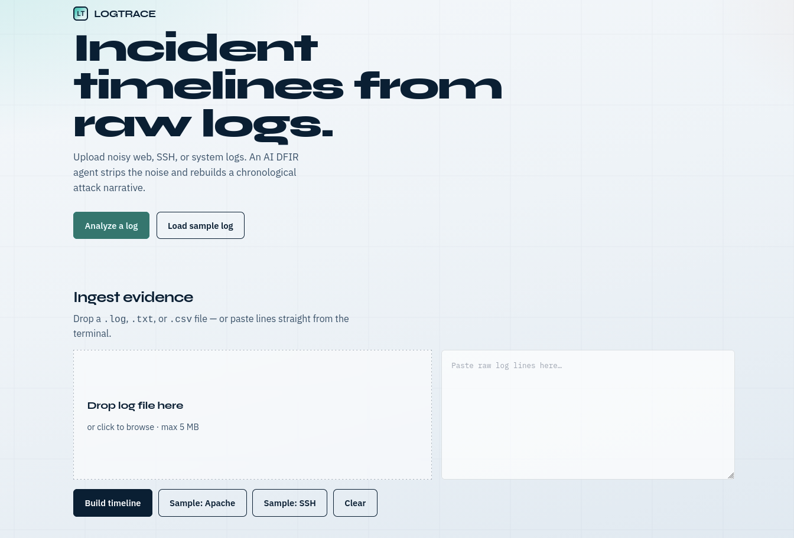
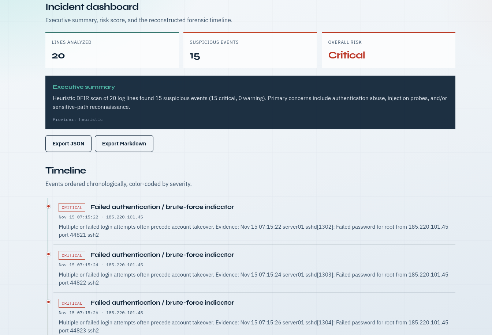

# LogTrace — Automated Log Forensics & Incident Timeline Builder

AI-assisted DFIR web application for filtering raw logs, generating structured incident timelines with risk scoring, and exporting reports in Markdown and JSON.

## Features

* **Log Input & Samples:** Upload log files (`.log`, `.txt`, `.csv`), paste raw log text directly, or load built-in sample logs (`apache` and `ssh`).
* **Preprocessing:** Strips empty lines and chunks large log inputs for reliable analysis.
* **AI DFIR Agent & Heuristic Fallback:** Uses structured JSON outputs via Gemini or OpenAI, and automatically falls back to a local heuristic IoC scanner when no API key is configured.
* **Timeline & Exports:** Displays summary dashboard cards, a color-coded incident timeline, and Markdown/JSON report exports.
* **Security Hardening:** Includes Content Security Policy (CSP) and security headers, restricted CORS origins, upload/text size limits, rate limiting, prompt-injection boundaries, output sanitization, and safe DOM rendering.

## Screeshots





## Project Structure

```text
LogTrace/
├── backend/
│   ├── __init__.py
│   ├── agent.py
│   ├── main.py
│   ├── models.py
│   ├── preprocessing.py
│   └── security.py
├── frontend/
│   ├── app.js
│   ├── index.html
│   └── styles.css
├── samples/
│   ├── sample_apache.log
│   └── sample_ssh.log
├── tests/
│   └── test_security.py
├── .env.example
└── requirements.txt
```

## Tech Stack

* **Backend:** Python 3.10+, FastAPI, httpx.
* **AI / Analysis:** Gemini API or OpenAI API (structured JSON), with a local heuristic IoC scanner fallback.
* **Frontend:** HTML5, Tailwind CSS (CDN), vanilla JavaScript.

## Quick Start

```bash
python3 -m venv .venv
source .venv/bin/activate
.venv/bin/pip install -r requirements.txt
cp .env.example .env
.venv/bin/uvicorn backend.main:app --reload --port 8000
```

Optionally set `GEMINI_API_KEY` or `OPENAI_API_KEY` in `.env` (or set `AI_PROVIDER=heuristic` to run without an external API key).

## API Endpoints

| Method | Path | Description |
| :--- | :--- | :--- |
| `GET` | `/api/health` | Health check |
| `GET` | `/api/sample?name=apache\|ssh` | Retrieve sample log content |
| `POST` | `/api/analyze/text` | Analyze raw log text from JSON body (`{ "text": "..." }`) |
| `POST` | `/api/analyze/file` | Upload and analyze a log file (`.log`, `.txt`, `.csv`) |

## Running Tests

```bash
AI_PROVIDER=heuristic python -m pytest tests/test_security.py -v
```

*(Note: Never commit `.env` or real API keys to version control; keep secrets in your local `.env` file.)*
